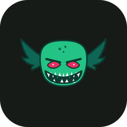
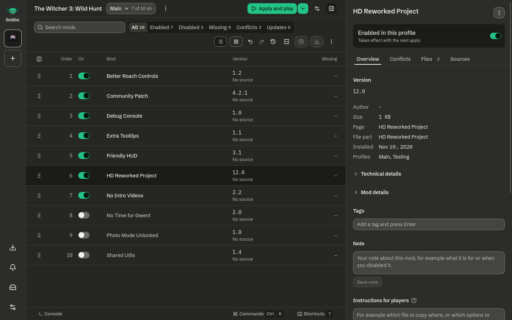
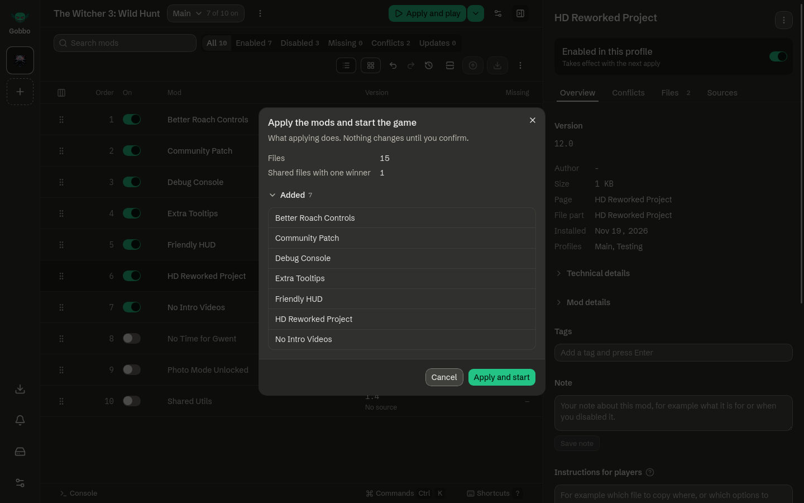
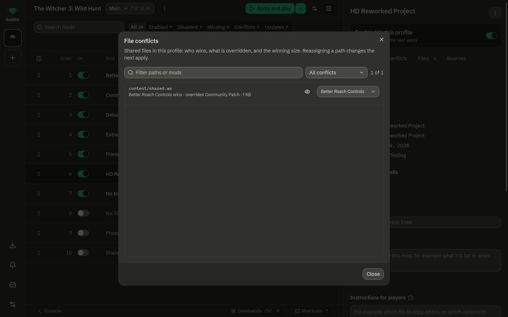
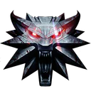
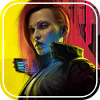
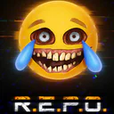
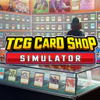
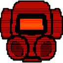
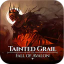

<p align="center">
  
</p>

<h1 align="center">Gobbo</h1>

<p align="center">
  <strong>A mod manager for PC games that keeps your game folder clean — on Windows and Linux.</strong><br>
  Profiles, load order, conflicts, mod packs and one-click downloads.
</p>

<p align="center">
  <a href="https://github.com/gaam24/Gobbo/releases/latest"><strong>Download the latest release</strong></a>
  ·
  <a href="#why-gobbo">Why Gobbo</a>
  ·
  <a href="#supported-games">Supported games</a>
  ·
  <a href="#documentation">Documentation</a>
  ·
  <a href="https://github.com/gaam24/Gobbo/issues/new/choose">Report a bug</a>
</p>

<p align="center">
  <a href="https://github.com/gaam24/Gobbo/actions/workflows/ci.yml"></a>
  <a href="https://github.com/gaam24/Gobbo/releases/latest"></a>
  <a href="LICENSE"></a>
  
</p>

<p align="center">
  
</p>

Gobbo Mods Organizer is a desktop mod manager for PC games. It keeps a separate mod list for every profile, shows conflicts before they reach the game, and applies mods through an overlay — so the real game folder stays untouched.

> **Status:** 0.1.0, early development. Five games are tested on real installations; four more definitions are ready for testing. See [Supported games](#supported-games).

## Why Gobbo

| What you get                              | How it helps                                                                                                                                                                             |
| ----------------------------------------- | ---------------------------------------------------------------------------------------------------------------------------------------------------------------------------------------- |
| 🧹 **A clean game folder**                | Overlay is the only way mods reach the game. The real folder stays untouched on Windows and Linux, and each profile gets its own layer.                                                  |
| 🌍 **Universal by design**                | Gobbo never special-cases a game or an engine. A game's layout lives in `games/<id>/game.toml` and shared loaders in `loaders/`; profiles, conflicts and packs work the same everywhere. |
| ↩️ **A way back for every change**        | History with undo and redo, a preview before every apply, and snapshots before a risky change.                                                                                           |
| ⚠️ **Conflicts you can see**              | Set the order, pick the winning file, add override rules and see what needs attention before you play.                                                                                   |
| 🐧 **Linux as a first-class platform**    | A native Linux app, games through Steam and Proton, and the same clean-folder workflow as Windows.                                                                                       |
| 🔒 **Your setup stays yours**             | Portable or global data, no account and no telemetry; provider keys live in the operating system's credential store. Free software under GPL-3.0.                                        |
| 📦 **Share a setup, not a pile of files** | A mod pack records the exact files, versions, installer choices, order and rules. Gobbo lists what's missing before it imports anything.                                                 |

## What it does

- **Import** — ZIP, 7z and RAR archives, Nexus `nxm://` and Thunderstore `ror2mm://` links, with installer options in a step-by-step wizard.
- **Organize** — a separate mod list for every profile, load order, separators, override rules, conflict winners, mod details, requirements, search and filters.
- **Apply** — write the enabled list into your profile's overlay layer. Preview what will change, see what needs attention and capture files the game or its tools write.
- **Update** — check Nexus Mods and Thunderstore for newer versions, update one mod or all of them, and undo the result.
- **Recover** — history with undo and redo, restore previews, snapshots and a guided search for the mod that breaks the game.
- **Share** — mod packs with exact files, versions, installer choices, order and separators, plus an import preview before anything changes.
- **Launch** — start a game from Gobbo or from Steam; Proton on Linux; game tools run inside the clean layer.
- **Workflow** — a `Ctrl+K` command palette, keyboard shortcuts, bulk selection, a first-run checklist and a window that fits any size.

## Screenshots



_The Apply preview shows what will be added, removed or updated before anything changes._



_The conflict explorer shows which mod wins a shared file and why._

_Screenshots use a demo library with example mod names._

## Installation

1. Download the archive for your system from [Releases](https://github.com/gaam24/Gobbo/releases/latest).
2. Check it against `SHA256SUMS.txt`.
3. Unpack it and start Gobbo:
   - **Windows:** `gobbo-<version>-windows-<arch>-portable.zip` is ready to run, or install with `Gobbo-Mods-Organizer_<version>_x64-setup.exe`.
   - **Linux:** `gobbo-<version>-linux-<arch>-portable.zip` is ready to run, or use the `.AppImage`.
4. Add a game, import a mod archive, switch the mod on and press **Apply**.

For a guided five-minute walkthrough, see [Quick start](docs/user/quickstart.md).

The first start asks where Gobbo should keep your data. **Portable** keeps the mods, profiles and settings in the program folder; **Global** uses the system's application data folder. See [Install and data](docs/user/install.md) for checksums, requirements and moving an existing setup.

## Documentation

| Guide                                           | What it covers                                                       |
| ----------------------------------------------- | -------------------------------------------------------------------- |
| [Quick start](docs/user/quickstart.md)          | Add a game, import a mod, apply it and undo it in about five minutes |
| [Install and data](docs/user/install.md)        | Downloads, checksums, requirements, storage modes and backups        |
| [Supported games](docs/user/games.md)           | What's tested today, how to add a game, and how mods reach the game  |
| [Linux and Steam](docs/user/linux.md)           | The Steam launch option, Proton and the overlayfs limits             |
| [Troubleshooting](docs/user/troubleshooting.md) | Common errors, the log and the support bundle                        |
| [All documentation](docs/README.md)             | The full map, including contributor and architecture guides          |

## Supported games

| Tested on a real installation                                                                                                | Ready for testing                                                                                                    |
| ---------------------------------------------------------------------------------------------------------------------------- | -------------------------------------------------------------------------------------------------------------------- |
|  The Witcher 3: Wild Hunt                   |  Valheim                                            |
|  Cyberpunk 2077                                      |  R.E.P.O.                                              |
|  TCG Card Shop Simulator                    |  Content Warning                            |
|  Lethal Company                                      |                                                                                                                      |
|  Tainted Grail: The Fall of Avalon |  The Witcher: Enhanced Edition |

A game is a data folder, not code: `games/<id>/game.toml`, with shared layouts in `loaders/<id>.toml`. If your game is missing, see [games/README.md](games/README.md). Some loaders, such as BepInEx for TCG Card Shop Simulator, still need a manual install. The full list and the test statuses are in [Supported games](docs/user/games.md).

## Platforms

- **Windows:** NSIS installer or portable archive. Overlay loads a hook DLL into the game process.
- **Linux:** portable archive. Overlay uses overlayfs in user namespaces, so your system must allow them.

The full matrix and the build commands are in [PLATFORMS.md](PLATFORMS.md).

## Linux and Steam

Gobbo shows the exact Steam launch option for each game. It has this form, with the path to the Gobbo executable:

```text
"/path/to/gobbo" run <game id> -- %command%
```

For example, for The Witcher 3 the game id is `the-witcher-3-wild-hunt`. Gobbo then starts the game in the clean layer when Steam launches it. See [Linux and Steam](docs/user/linux.md) for Proton and overlayfs details.

## Portable and global data

The first start asks where Gobbo should keep its data:

- **Portable:** `<program folder>/data`, with the choice recorded in `<program folder>/gobbo.storage.json`. The library, profiles, settings and logs stay with the program, so the folder can be moved as a whole. Deleting the folder deletes the library.
- **Global:** `%APPDATA%\dev.gobbo.modsorganizer` on Windows, or `$XDG_DATA_HOME/dev.gobbo.modsorganizer` (`~/.local/share/dev.gobbo.modsorganizer`) on Linux.

The Nexus API key stays in the operating system's credential store, and the `nxm://` and `ror2mm://` handlers are an opt-in system integration; neither moves with the folder. See [Install and data](docs/user/install.md#where-your-data-lives).

## FAQ

<details>
<summary>Does Gobbo modify my game folder?</summary>

No. The game folder stays untouched and each profile gets its own layer. **Undo apply** takes the deployment out and leaves the layer ready for the next apply.
</details>

<details>
<summary>Do I need an account to use Gobbo?</summary>

No — Gobbo has no account of its own. Downloading mods directly from a provider is optional: an `nxm://` link carries its own short-lived key, and Thunderstore needs no key. A saved provider key only adds update checks and direct downloads. See [Nexus Mods and Thunderstore](docs/user/providers.md).
</details>

<details>
<summary>Can I launch games through Steam and Proton?</summary>

Yes. On Linux, Gobbo shows the Steam launch option for each game and starts the game in the clean layer when Steam launches it. You can pick a Proton build per game from the ones found on your computer.
</details>

<details>
<summary>Can I move my setup to another computer?</summary>

Yes, in portable mode: move the program folder with its `data` folder. Profiles and mod packs can also be exported and imported. Machine-specific paths, such as the game folder and the Proton build, are asked for again.
</details>

## Development

This section is for people working on Gobbo itself.

### Building from source

You need [Bun](https://bun.sh) 1.4.4, Rust 1.97 or newer, and the [Tauri 2 prerequisites](https://v2.tauri.app/start/prerequisites/) for your system.

```bash
git clone https://github.com/gaam24/Gobbo.git
cd Gobbo
bun install
bun run tauri dev
```

The full setup and the checks are in [CONTRIBUTING.md](.github/CONTRIBUTING.md).

### Contributing

Bug reports, game definitions and code are welcome. A new game is a data folder, not a code change; see [games/README.md](games/README.md). Read [CONTRIBUTING.md](.github/CONTRIBUTING.md) before you open a pull request. Open work is tracked in [GitHub issues](https://github.com/gaam24/Gobbo/issues).

## Security

Please report vulnerabilities privately, not in a public issue. See [SECURITY.md](.github/SECURITY.md).

## Changelog

Release history is in [CHANGELOG.md](CHANGELOG.md).

## Disclaimer

Gobbo does not include game files or mods. It is not affiliated with any game publisher, Valve, Nexus Mods or Thunderstore. Game, store and service names are trademarks of their owners.

Mods change what the game sees and can break a game or its saves, so back up your saves first. The overlay on Windows loads a hook DLL into the game process. Do not use mods, or the overlay, with online games that do not allow it.

## License

Gobbo Mods Organizer is free software under the [GNU General Public License v3.0](LICENSE).
