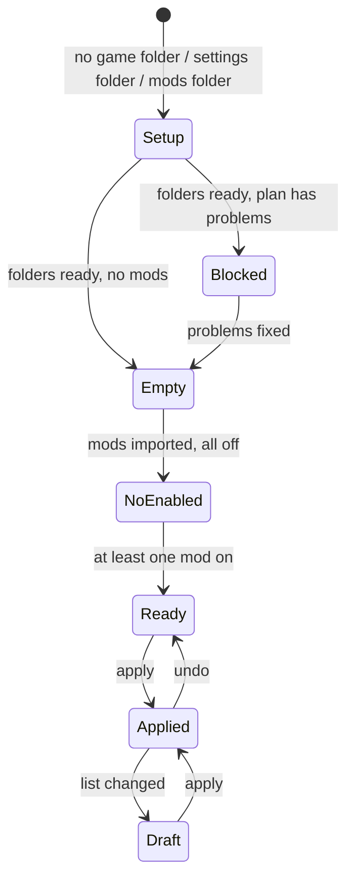
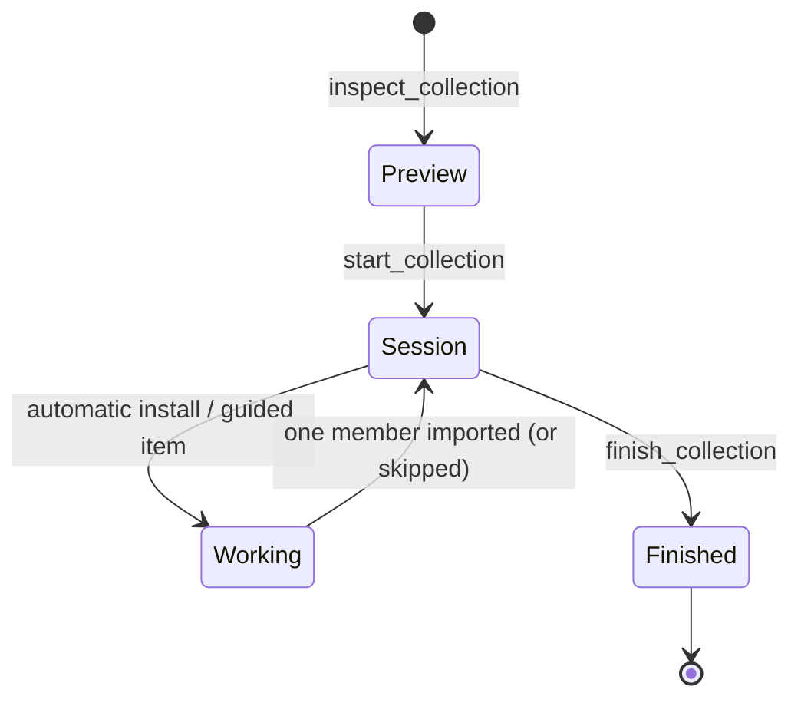

# State machines in Gobbo

This file is the short, executable map of the states a screen can be in. Read it before adding a state, an action or a
message that depends on the game. The code is the source of truth; this file explains where that truth lives.

## The game stage

The backend derives one `GameStage` and one `NextAction` for every status. The window never derives the stage from
booleans. The types live in `src-tauri/src/status/stage.rs`, the status fields in `src-tauri/src/status/views/mod.rs`, and
the one presentation in `src/app/selectors/game-presentation.ts`.

The order of the checks is the order a person follows:

| Stage        | Meaning                                            | Next action                                                   |
| ------------ | -------------------------------------------------- | ------------------------------------------------------------- |
| `setup`      | A folder the game needs is missing                 | `set_game_folder` / `set_settings_folder` / `set_mods_folder` |
| `blocked`    | The game and list are ready, the plan has problems | `fix_problems`                                                |
| `empty`      | The library has no mods                            | `import_mods`                                                 |
| `no_enabled` | The library has mods, none is on                   | `enable_mods`                                                 |
| `ready`      | At least one mod is on, the list is not applied    | `apply`                                                       |
| `draft`      | The applied list changed                           | `apply`                                                       |
| `applied`    | The applied list matches the deployment            | `play`                                                        |

### Rules

- A missing folder wins over a plan problem: the user cannot fix a plan for a folder that is not there.
- A plan problem wins over the list: an apply would fail.
- `applied` means the deployed list matches the enabled list. A change of a file on disk is not a draft today.
- The stage does not include the runtime. `gameRunning` and `busy` are a separate overlay, because the game can start
  and stop without a new status.

## The presentation

`gamePresentation(status, runtime)` is the only place that turns the stage into words and actions. The header, the
command palette and the inspector read its `primary`, `menu`, `canApply`, `canPlay`, `canDiscard`, `canUndo`,
`blockedReason` and `nextStep`. A new screen must use it instead of writing its own `if (status.deployed)`.

Runtime overlay:

| Runtime           | What the user sees | Primary action                      |
| ----------------- | ------------------ | ----------------------------------- |
| `gameRunning`     | `Game running`     | `Stop`                              |
| `busy: applying`  | `Applying…`        | `Apply` disabled, Undo/Discard stay |
| `busy: launching` | `Launching…`       | `Play` disabled, Undo/Discard stay  |
| `busy: stopping`  | `Stopping…`        | `Stop` disabled, Undo/Discard stay  |

Only the action whose own work is running is disabled; a busy game still has a legible primary and keeps the other
actions and the Working-panel controls.

## Setup check

`src-tauri/src/status/preflight.rs` turns the same `Status` into a `PreflightReport`: game folder, settings folder, mods
folder, loader, overlay support, free space and the running game. It never re-derives the folder rules; it reads the status
fields. The overlay check is `deploy::overlay::check_support`; the free space is `infra::disk::space_for`.

The dialog is `src/views/setup/setup-dialog.tsx`. The first added game opens it after `Add`; the header menu and the
command palette open it at any time. A check with a problem carries the action that fixes it: game settings for a folder
or method, the mod list for a plan problem, Storage for space. A loader requirement with a name and URL in the game or
loader definition says **Get `name`** and opens that page in the browser through `open_requirement_page`; the URL comes
from the definition, never from the window.

## Requirements

`SourceRequirements` (`src/sources/source-requirements.tsx`) lists the provider requirements of a mod with their state in
the profile. A missing requirement whose provider can download directly offers **Get**: `install_requirement` downloads
the file, imports it and enables it in the active profile, or only enables a version that is already in the library. A
provider without direct downloads keeps its page link as the fallback. The row's `direct_download` flag is the only
decision the window makes; the provider owns the method.

## Long-running work

The backend task registry is the single source of truth for the **Working** card. The window hydrates it with
`listTasks` and follows the `task-started`, `task-finished` and `task-cancelled` events; no screen derives a row from its
own busy flag or local queue. A task is keyed by its game (and, for a collection install, by profile and collection), so
it outlives a dialog close or a game switch and always names the game it belongs to. The states are `running`, `waiting`
(a step the user must take) and `failed` (with its message). The registry keeps a journal next to the app data: running
work interrupted by a restart comes back as a failed row with Retry, and a waiting row comes back as waiting. Terminal
rows are removed, so a restart does not resurrect finished work.

Each row offers the actions that fit its state: **Stop** cancels a running task, **Open** switches to that task's game
and restores its window, **Retry** restarts a failed or waiting task, and **Dismiss** clears a failed row. The actions
work from any screen, including while another game is active. Progress comes from the Channels the work already sends —
`DeployProgress`, `UpdateProgress`, `UpdateAllProgress`, `ImportProgress` and the download channel — so a row shows the
real percent and `3 of 42 files`, never a count the backend did not send.

The card groups rows by state (failed, waiting for you, running) and then by game, with a count for each group. A task
waiting on the user has its own icon and label, so it does not look like one that is still running. The live region speaks
only a state change — a failed or waiting count moving — never each percent tick, so a screen reader hears the stage once.
Tool runs and prerequisite installs also appear as rows for their whole duration; toasts carry only completed results,
and a result whose recovery must outlive the toast (Undo) keeps its action in **Notifications**. When the window is
hidden or minimized, the same task events also become system notifications: `waiting`, `failed` and `done` (`cancelled`
never speaks). Each `<task kind>.<outcome>` code (`import.failed`, `import.done`, ...) has its own switch in the
settings; `waiting` follows only the main switch. The tray owns the message; clicking one restores the window and opens
**Working**.

## Updates and the provider account

`SourceAccount.direct_download` says whether the account behind a saved key may fetch a provider file without its web
page. Gobbo checks the saved keys once at startup, without a notice when the check fails, and again after a key is saved
or when the saved key is checked. An unknown account is not treated as free: the first update tries the direct download,
and a `source.payment_required` answer opens the mod's files page and remembers the browser mode for the rest of the
session.
`SourceProviderInfo.direct_download` covers a provider that never downloads directly, even without a key.

**Update all** asks the same access question for every provider of its targets. Mods the account can download directly,
and mods whose newest version is already installed, go through the backend pass. The rest open the browser step: each
files page is opened in turn, a matching entry in the shared download queue moves to the next mod as soon as the download
starts, and `select_update_version` selects the imported version when its import ends. The step offers **Next** and
**Close** at all times; closing it no longer stops the sequence. A download already started still imports itself, and
the rest of the run is controlled from **Working**, where it can be stopped or reopened. A finished browser run uses one
undo for every version it selected. The normal import banner is unchanged for a download that did not come from this
step.

## Collection install

A collection adds one more long task and one more profile state. The backend owns both: there is one controller per
install, keyed by game, profile and collection, and the dialog sends one round command at a time; the backend drives the
automatic members through `acquire` and returns a prompt descriptor when a member needs a decision. Closing the dialog
does not pause the install, and a restart leaves the controller on its last step — its row stays in **Working** with the
game's name.
**Stop** cancels that controller through `cancel_collection`; **Open** switches to the collection's game first and
restores the install view. Several installs can run at once, on one game or across games. A round still pauses on FOMOD
choices; the controller resumes it after the wizard saves the answers, even if the install window was closed in the
meantime.

| State    | Source of truth                                                                                                 | What the window does                                                                                                   |
| -------- | --------------------------------------------------------------------------------------------------------------- | ---------------------------------------------------------------------------------------------------------------------- |
| preview  | `CollectionPreview` from the provider revision and plan                                                         | shows statuses, optional selection, profile and mode                                                                   |
| session  | `CollectionSessionView` with `statuses`, `counts` and `next`                                                    | install view / panel; never derives a member state                                                                     |
| working  | the task registry row plus `CollectionProgress` over a channel, or `CollectionItemAction` for one guided member | repeats the automatic round or asks for the next guided file; reads the round from **Working** after a close or switch |
| finished | `finish_collection` returns the settled session                                                                 | **Apply now** hands off to the normal deploy                                                                           |

A FOMOD with no stored choices answers `needs_choice`, and the window shows the shared wizard. A free account's file
page answers `waiting`; the owned download is imported by the window and never auto-installed by the queue. A member
the user skips for now stays pending and is deferred only by the window; a permanent skip is stored in the profile
origin (`origin.excluded`). Bundles, direct URLs and patches are handled inside a round in both modes.

## Status and sync

`src-tauri/src/status/mod.rs` has one builder for the status. `status` is the pure read: it applies `sync_profiles` to
the loaded list in memory, so the window sees imported or removed mods without a restart, but it never writes.
`sync_profiles` is the `change` command that saves that step. The window calls it when a game opens, after an import
(`use-import.ts`) and after a mutation (`reload` in `use-game-actions.ts`). `Profiles::read_or_default` returns the
default profile without creating `profiles.json`; the first real save writes it. The one exception to the pure read:
the first status of a game creates its empty `library/` and `archives/` folders, which belong to Gobbo, so the first
import already has them. It creates no profile, settings file or other state.

## Navigation

`src/app/contexts/navigation-context.tsx` keeps the current view and a back stack. `navigate` pushes the current view;
`back` pops it. The two roots are `mods` and `games`; every other screen gets the global **Back** button in
`src/app/shell/app-main.tsx`. There is no URL router and no forward history.

## Dialogs

`src/app/contexts/ui-context.tsx` keeps a stack of shell dialogs, oldest first. `openDialog` pushes, `closeDialog` pops,
`closeAllDialogs` resets. Only the last one is drawn. The palette does not open above an open dialog. A game switch
closes the stack, but closing a dialog no longer stops the work it started: the task stays in **Working** under its own
game and can be reopened from there. `showDetails(tab)` also records the tab the inspector should show; the conflict
counter uses it to open **Conflicts** on the same mod. **Change installer options** opens a FOMOD wizard that starts from the answers saved with
the version, and reinstalls with the new ones.

## Errors

`AppError` carries an optional `recovery` with a `RecoveryAction` and an optional target. `src/lib/ipc.ts` exposes
`recoveryOf`; `src/components/app/error-recovery.tsx` turns it into a button. A new user-action error should name the
step that fixes it, not only the code.

A render failure is caught by `src/components/app/error-boundary.tsx`. There is one boundary around the whole shell and
one around each page (keyed by the view), so a broken screen shows the fallback while the rail and the other screens stay
usable. The fallback never claims data loss: the library, profiles and deployments are in the backend.

## Adding a state or an action

1. Add the variant to `GameStage` or `NextAction` in `src-tauri/src/status/stage.rs`.
2. Update `game_stage` and its test table. The checks are ordered; say where the new state sits.
3. Regenerate `src/bindings.ts` with `cargo test --lib write_bindings -- --ignored`.
4. Add the case to `gamePresentation` and its test. The switch is exhaustive: a missing case is a type error.
5. Add the label to `src/locales/en.ts` and `pl.ts`.
6. If the state changes what a screen shows, update the header, palette and inspector through the presentation only.

## Tests

- `src-tauri/src/status/stage.rs`: the ordered stage rules.
- `src/app/selectors/game-presentation.test.ts`: every stage, the runtime overlay, the next step and the blocked reason.
- `src/lib/mods.test.ts`: the list rules; it no longer carries a second deployment blocker.
